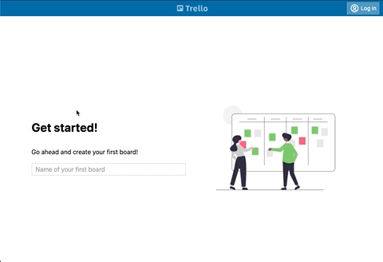

## Trello App — Workshop Project

<p align="center" width="100%">
    
</p>

A Trello clone built with React + TypeScript + Vite + TailwindCSS, used for testing workshops.

## Installation

Run the setup command in your terminal:

```bash
bash <(curl -fsSL https://raw.githubusercontent.com/filiphric/trelloapp-workshop-app/main/setup.sh)
```

The installer will:
1. Check that you have `git`, `node` (v20+) and `npm` installed
2. Clone the project and set up a clean git history
3. Ask you to choose between **Full install** (with tests) or **Clean install** (app only)
4. Install dependencies and verify everything works

Once done, start the app:

```bash
cd trelloapp
npm start
```

The app will be running at [http://localhost:3000](http://localhost:3000).

### Manual installation

If you prefer to set things up yourself:

```bash
git clone https://github.com/filiphric/trelloapp-workshop-app.git trelloapp
cd trelloapp
npm install
cp .env_example .env
npm start
```

### Troubleshooting

If the setup fails (common on work machines with restricted permissions):
- Ask your system administrator to install **git** and **Node.js v20+**
- If your company uses a VPN or proxy, ask IT to allowlist `github.com` and `registry.npmjs.org`
- Contact the workshop instructor for help


## Mailosaur + GitHub Actions password reset demo

This branch deliberately contains a broken reset link for a debugging workshop.
The email points to `/resetpassword`, while the React route is `/reset-password`.
The Cypress browser test should fail on the application's 404 page; the API safeguards
should pass. Fix the URL in `backend/api/password-reset-routes.ts` to complete the demo.

### Run locally

```sh
npm ci
cp .env_example .env
# Fill in SMTP and Mailosaur settings in .env
npm start
# In another terminal:
npm run test:cypress
```

Open `/login` and choose **Forgot your password?**. Reset links expire after 15 minutes,
are single-use, and are stored as SHA-256 hashes in memory. Passwords are hashed with
bcrypt, compatible with the existing login backend. Restarting the app invalidates
outstanding reset tokens. Requests for unknown accounts return the same confirmation;
repeat requests for one address are suppressed for 60 seconds.
This training app retains its existing session/authentication behavior; password changes
do not revoke previously issued access tokens.

For another local port, set `APP`, `SERVER`, and `APP_BASE_URL` together in `.env`.
Cypress uses `APP_BASE_URL` as its base URL. GitHub Actions uses port 3000.

### GitHub Actions

Set repository secrets `SMTP_HOST`, `SMTP_PORT`, `SMTP_USER`, `SMTP_PASS`, `FROM_EMAIL`,
`MAILOSAUR_API_KEY`, and `MAILOSAUR_SERVER_ID`. Credentials stay out of source control.
The **Mailosaur password reset demo** workflow runs on pushes to `main` and `demo/**`,
and supports manual dispatch. PRs run the same Cypress specs. Type checking is separate.

Each test uses a unique Mailosaur recipient and retrieves only messages sent since the
test started. The workflow uploads screenshots, videos, and `reset-message.json` as the
`password-reset-evidence` artifact. The JSON contains the recipient, Mailosaur message ID,
subject, time window, and URL pathname so the agent can find the exact email using MCP.
It omits the reset token. Existing messages are preserved.

Suggested live prompt:

> Investigate the failed password reset test in this GitHub Actions run. Download its
> evidence artifact, use Mailosaur MCP to inspect the exact email, fix the cause, and
> rerun Cypress. Open a PR with the fix.

Tests cover invalid inputs/tokens, matching responses for unknown accounts, password
changes, single-use tokens, and the full email-link-to-login journey. The browser test
also confirms that the old password no longer works after a successful reset.
